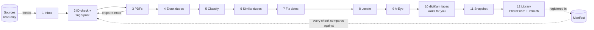

# Architecture

## The funnel

Files enter from triage's `sorted/images` and `sorted/raw` folders and move through twelve stages. Each stage can take a
file out of the flow into an [excluded folder](excluded-reasons.md). Whatever
reaches the library is registered in the manifest, and the next drop is checked
against all of it.



| # | Stage | What it does |
|---|---|---|
| - | **Catalogue** | Read-only inventory of a source before anything is fed in |
| 1 | Inbox | Files arrive here from the feeder or a manual drop |
| 2 | ID check + fingerprint | Reads an existing pipeline ID from the metadata or the `<ID>_` file-name prefix (re-entry check), otherwise assigns one; SHA-256, pixel hash, perceptual hashes for all 8 rotations/mirrors |
| 3 | PDFs | Identical PDFs out, document PDFs out, photo pages split by ScanSplitter; crops re-enter at stage 2 |
| 4 | Exact dupes | Byte-identical and pixel-identical matches against every file before |
| 5 | Classify | Photo, document, screenshot or meme (SigLIP/CLIP, OCR text density, vision-model tiebreak) |
| 6 | Similar dupes | 97%+ similar, including crops and rotations; keeps the best copy and merges metadata into it; RAW files get a working copy |
| 7 | Fix dates | EXIF repair, scanner detection, approximate dates for scans |
| 8 | Locate | Only for photos with no GPS: time-neighbour GPS, then GeoCLIP / vision guess, tagged with confidence |
| 9 | A-Eye | Rename, blur/accidental-shot check, description - embedded into the file |
| 10 | digiKam faces | Pauses until you have named faces in digiKam and released the batch |
| 11 | Snapshot | ZFS snapshot; files frozen before indexing |
| 12 | Library | PhotoPrism index, Immich read-only external library |

## Folder layout

Decided 27 Nov 2026 (the ImagePipe folders are built in phase 2). Everything
still being worked on, and everything that isn't a finished photo, lives in the
**filestack** on bulk storage (`IMAGEPIPE_FILESTACK`, one mount with the
triage sources, so every move is an instant rename). Only finished photos go to
the library on fast storage.

```text
<filestack>/                      e.g. /wolf-pool/vault/filestack
├── triage/work/                  triage extracts archives here
├── imagepipe/
│   ├── processing/<batch>/       stages 2-8 (the stage is tracked in the manifest, not by folder)
│   ├── a-eye/<batch>/            the only folder A-Eye sees
│   ├── digikam/<batch>/          the only folder digiKam sees
│   └── ready/<batch>/            checked, waiting to be copied to the library
└── sorted/
    ├── images/ raw/              triage output that ImagePipe picks up
    ├── documents/ video/ ...     other categories (final, or another pipeline's)
    ├── raw-processed/            RAW originals after their working copy was made
    ├── quarantine/<reason>/
    └── excluded/<reason>/        photos ImagePipe took out of the flow

<library dataset>/                e.g. /mnt/appdata/imagelibrary (NVMe)
├── library/YYYY/YYYY-MM/         finished photos only (+ undated/) - PhotoPrism and Immich read this
└── imagepipe/                    manifest, triage database, logs, reports
```

A batch is one calendar month of photos (by date taken), split above 2,000.
The finished photo is copied to the library with copy -> verify checksum ->
remove.

## Components

ImagePipe is one Python application in one container. It talks to the services
you already run through their APIs rather than bundling them:

| Service | Used by | How |
|---|---|---|
| ScanSplitter | stage 3 | HTTP API |
| Vision model server (vLLM, Ollama or other OpenAI-compatible) | stages 5, 8 | OpenAI-compatible API |
| A-Eye | stage 9 | its API |
| digiKam | stage 10 | you work in its UI; ImagePipe waits for release |
| PhotoPrism, Immich | stage 12 | their APIs (index/rescan, albums) |
| Apprise API | all | HTTP, see [Notifications](notifications.md) |

Every stage can be switched off in the config, so ImagePipe works for someone
who doesn't run A-Eye or digiKam.

## State

The [manifest](manifest.md) records the stage each **file** is at, not each
batch. Each stage works through whatever is waiting for it, so a new drop keeps
flowing while older files wait at the digiKam pause.
